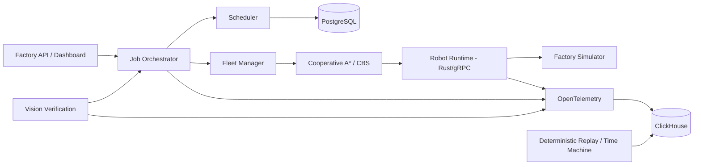

# Autonomous Microfactory OS

A portfolio-grade robotics software platform for simulating and orchestrating a small autonomous factory. It demonstrates software architecture, robot/device abstractions, scheduling, fleet coordination, vision verification, observability, deterministic simulation/replay, fault handling, and a low-level Rust runtime boundary.

> **Validation boundary:** the Python platform and retained simulation/benchmark layers are unit/integration tested locally. Rust/gRPC, OR-Tools CP-SAT, live PostgreSQL/ClickHouse and final full-stack integration remain explicit milestones. No physical hardware, production deployment or safety certification is claimed.

## Why this project exists

It complements the ROS 2 warehouse robot and vision-guided manipulator projects by focusing on the software architecture behind a **multi-machine / multi-robot factory**, not one robot.

## Implemented pre-integration platform

### Factory/domain
- typed jobs/tasks/resources and legal state transitions
- DAG validation and dependency readiness
- idempotent command handling
- explicit failed-task retry semantics
- FastAPI job boundary, health/capability APIs and retry endpoint
- YAML manufacturing job DSL

### Fleet
- A*
- time-expanded A*
- temporal reservations
- cooperative multi-robot planning
- Conflict-Based Search reference planner
- persistent goal occupancy through planning horizon
- robot health/battery-aware mission eligibility
- deterministic stress generation

### Scheduling
- FIFO baseline
- priority
- shortest-processing-time (SPT)
- earliest-due-date (EDD)
- weighted heuristic
- retained benchmark workload ready for CP-SAT comparison

### Vision
- deterministic OpenCV alignment
- PASS / RETRY / FAIL / HUMAN_REVIEW policy
- lazy ONNX inference boundary
- synthetic benchmark fixtures

### Reliability / observability
- deterministic simulation clock and event digests
- replay reconstruction + first-divergence debugging
- replay timeline representation
- Python OpenTelemetry trace/correlation plumbing
- ClickHouse DDL/injectable sink boundary
- PostgreSQL schema/migration preparation
- deterministic fault schedules
- 100-seed domain/scheduler invariant campaign

### Portfolio/demo surfaces
- `/dashboard` — simulation-preview factory dashboard
- `/time-machine` — deterministic replay/failure timeline preview
- CLI for job validation, fleet stress and fault schedule generation
- measured benchmark reports under `docs/generated/`

## Architecture



## Measured pre-integration evidence

All values below are **local simulation/software measurements**, not production claims.

Retained multi-seed cooperative-planner runs currently cover 10, 25, 50, 75 and 100 robots. See:

- `docs/generated/fleet_multiseed_100.csv`
- `docs/generated/pre_codex_benchmarks.md`
- `docs/generated/fleet_planner_evaluation.md`

The 40 retained multi-seed cases through 100 robots were conflict-free. On this runtime the median planning latency increased from single-digit milliseconds at 10 robots to roughly 1.5 seconds at 100 robots, which gives the project an explicit scalability trade-off to discuss and optimise.

Scheduler baselines are retained in `docs/generated/scheduler_baselines.csv` so OR-Tools CP-SAT must be compared against deterministic heuristics rather than against no baseline.

## Run locally

```bash
python -m pytest -q
python -m compileall -q src tests apps
python tools/microfactory.py validate-job scenarios/jobs/pcb_batch_104.yaml
python tools/microfactory.py stress --robots 50 --grid 40 --seed 3
python tools/microfactory.py faults --robots 10 --count 10 --seed 7
```

Run the pre-Codex quality gate:

```bash
python tools/pre_codex_gate.py
python tools/pre_codex_gate.py --full
```

If running the FastAPI application, open:

```text
/dashboard
/time-machine
/healthz
/capabilities
```

## What is deliberately left for Codex/Work

1. compile and harden the Rust runtime
2. typed command lifecycle + heartbeat/watchdog
3. protobuf/gRPC generation and service integration
4. OR-Tools CP-SAT scheduler and final benchmark comparison
5. live PostgreSQL repository/integration tests
6. Rust/cross-process OpenTelemetry propagation
7. live ClickHouse integration/query tests
8. persisted deterministic replay across the real service boundaries
9. final golden/failure full-stack E2E
10. final recruiter README/demo using only measured integrated evidence

See `tasks/TASKS.json`, `docs/context/CURRENT_STATE.md`, and the Work handoff prompt.
