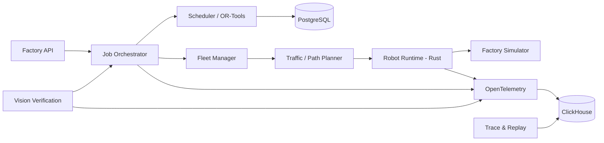

# Autonomous Microfactory OS

A portfolio-grade robotics software platform for simulating and orchestrating a small autonomous factory. The project is designed to demonstrate software architecture, robot/device abstractions, scheduling, fleet coordination, low-level runtime boundaries, vision verification, persistence, observability and replay.

> **Current status:** architecture, contracts, test strategy, task graph and a small verified Python planning core are prepared. The full factory runtime, vision pipeline, database services and Rust control bridge are implementation milestones. No physical hardware validation is claimed.

## Why this project exists

The project complements the existing ROS 2 warehouse robot and vision-guided manipulator repositories by focusing on the software architecture behind a multi-machine factory rather than on a single ROS 2 robot.

## Target capabilities

- Python orchestration and optimisation
- Rust robot/runtime boundary
- typed contracts between high-level planning and low-level control
- multi-robot path planning and temporal reservations
- resource-constrained job scheduling
- machine-vision verification with OpenCV / ONNX Runtime
- PostgreSQL durable state
- OpenTelemetry tracing and ClickHouse telemetry
- deterministic simulation and event replay
- automated unit, integration and end-to-end testing
- clear simulation-vs-hardware validation boundaries

## Planned system



## Repository map

- `src/microfactory/domain` — core typed domain model and state rules
- `src/microfactory/fleet` — grid, path planning and temporal reservations
- `services/` — future Python services
- `rust/robot_runtime` — low-level typed robot state-machine boundary
- `contracts/proto` — language-neutral RPC contracts
- `docs/context` — compact context pack for coding agents
- `docs` — architecture, test, demo and role-mapping material
- `tasks/TASKS.json` — bounded implementation tasks with acceptance checks

## Local verification available now

```bash
python -m pytest -q
python -m compileall -q src tests
```

The Rust scaffold is intentionally dependency-light but is **not locally compiled in this preparation environment** because a Rust toolchain is not installed here. CI should validate it once pushed.

## Milestones

1. Repository and contracts
2. Domain model and orchestration
3. Deterministic factory simulator
4. Rust robot runtime and command gateway
5. Fleet traffic management
6. Resource-constrained scheduling
7. Vision pick/placement verification
8. Persistence, tracing and replay
9. Agentic fault diagnosis with evals
10. Benchmarks, demo capture and interview documentation

See `ROADMAP.md` and `tasks/TASKS.json`.
